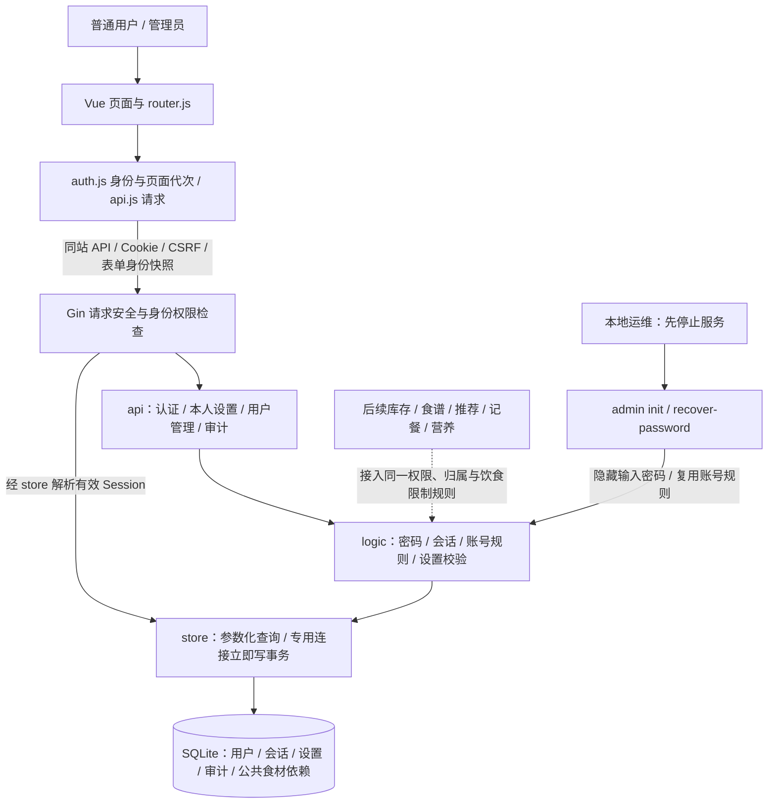

# 用户模块待实现架构与实施边界

日期：2026-10-19。架构已由用户确认；下文保留方案阶段基线与实施边界。后续实现及验证见 [本轮总结](USER_MODULE_IMPLEMENTATION_SUMMARY.md)。

依据：[技术设计](USER_MODULE_TECHNICAL_DESIGN.md)、[总实施方案](../../IMPLEMENTATION_PLAN.md)、[第三轮评审](USER_MODULE_TECHNICAL_DESIGN_REVIEW_ROUND3.md)。

## 1. 实际基线

当前仓库仅有方案和评审 Markdown，没有 `server/`、`web/`、依赖清单、业务数据库或测试入口。以下为将要实现的代码架构，不是从现有源码还原的调用图。现有用户修改保留，不覆盖原设计。

本轮架构复核、测试用例编写和架构图制作分别由子 Agent 协作完成，主 Agent 汇总并核对一致性。第三轮设计评审通过不替代用户要求的本轮架构说明确认。

## 2. 架构图

[交互 HTML 架构图](../../.archify/architecture-user-module-20261019-014414/user-module.html)及[自动检查回执](../../.archify/architecture-user-module-20261019-014414/user-module.finalize-summary.json)由同轮独立产物提供。架构类型为 architecture；validate、deliver、strict check 和 browser-check 均通过，零诊断；未做截图或人工视觉验收。这些仅是图产物检查，不是应用功能测试。图中的后续业务节点表示接入要求，不表示已经实现这些功能。

## 3. 每层职责及调用边界

| 层 | 拟新增位置 | 职责与边界 |
| --- | --- | --- |
| 启动和配置 | `server/cmd/server/main.go` | 校验监听地址、Origin、Cookie 模式、可信代理、数据库和密钥；默认环回监听；加载数据库、迁移与清理任务，负责退出清理 |
| 本地管理 | `server/cmd/admin/main.go` | 显式初始化首个管理员、恢复已有 active admin；密码只从隐藏终端输入；服务运行时不得执行维护写操作 |
| HTTP | `server/internal/api/` | 注册、登录、退出、本人信息/改密/设置、管理员用户及审计接口；严格 JSON、大小限制、统一错误、响应安全头和 no-store |
| 请求门禁 | `server/internal/api/middleware.go` | 有效 Session 上下文、Origin/CSRF、强制改密白名单、当前角色和旧表单身份断言；认证写接口的 CSRF 在业务变更前完成 |
| 业务规则 | `server/internal/logic/` | Argon2id、用户名和密码校验、哈希并发保护、限流、账号管理不变量、设置校验及可供后续推荐使用的硬限制规则 |
| 数据访问 | `server/internal/store/` | SQL、约束错误映射、会话与当前用户联合查询；专用连接立即写事务；事务内复核及审计；不在事务中向 DB 再取连接 |
| 数据定义 | `server/migrations/` | 用户、Session、设置、审计、必要公共食材结构；迁移版本和校验值；空库创建最终结构，不自动删除字段降级 |
| 前端 | `web/src/views/`、`api.js`、`auth.js`、`router.js` | 六类页面、身份恢复、请求错误处理、CSRF 更新、路由守卫；无额外状态管理库，不持久化密码或 Session |
| 验证与运行资料 | 相邻 Go 测试、前端测试、配置示例、运行文档 | 测试用例追踪、真实临时 SQLite 测试、必要浏览器交互和最终响应头验收、管理员及备份恢复说明 |

沿用 api → logic → store，不增加 ORM、通用 repository、权限引擎、Redis 或 JWT。身份门禁也通过 store 查询数据库；逻辑层不能自行拼 SQL，CLI 不调用 HTTP 或提供网络旁路。

## 4. 关键流程与安全不变量

### 4.1 注册与登录

注册按来源/CSRF/限流 → 严格参数校验 → 事务外哈希 → 事务插入普通用户及默认设置。数据库唯一约束处理并发重名；创建设置失败则用户也回滚。

登录按来源/CSRF/限流 → 校验真实或虚拟哈希 → 立即写事务复核 active、auth_version、原密码哈希 → 保存新 Session 摘要 → 提交后设置 Session Cookie 并轮换 CSRF。密码校验后的重置/禁用不能留下有效新会话。哈希不占用写事务。

每次请求按数据库中的 Session、到期、账号状态和认证版本解析身份，并读取当前角色。失效 Session 清理后作为匿名；数据库故障返回错误，不能当作匿名处理。

### 4.2 身份、CSRF 与多标签页

匿名 CSRF 与有效 Session 绑定的 CSRF 用途不同；所有写请求先检查精确 Origin 和 CSRF，登录成功轮换令牌。CSRF_INVALID 时只刷新令牌和核对身份，再提示重新提交，不自动重放写请求。

受保护写请求的 X-Expected-User-ID 由页面/表单创建时的身份快照显式传给 api.js，不能在发送时自动取当前全局用户。缺失或格式错误返回 400，身份不同返回 409 IDENTITY_CHANGED，且不能写入业务数据。409 后丢弃旧表单，重新获取身份并加载页面。注册、登录和幂等退出按原设计豁免该 Header。

BroadcastChannel 广播“身份可能变化”，不携带凭据；focus/visibility 和提交前复核补充保护。身份改变清理缓存、表单、内存 CSRF 并递增请求代次，旧异步响应不得回填；身份检查失败期间暂停提交。

### 4.3 管理与改密

管理写事务内再次验证操作者有效 Session、active、版本、无强制改密状态及 admin 角色，随后检查禁止自管理、至少一个 active admin、目标账号、会话撤销和审计。所有变更和审计原子提交。

改密/禁用/重置同时提升 auth_version 并删除目标全部 Session。重置后只允许身份查询、退出、改密与 CSRF；新密码不能沿用临时密码。管理员没有直接读他人业务数据的权限，但重置能力可以接管账号，首版明确将其纳入可信边界。

### 4.4 设置与事务

设置完整替换；归属只从 Session 获取。过敏和忌口是硬限制，偏好只用于排序；目标数值不是医学推荐。已有停用忌口可保留，新增停用项拒绝，读取缺失设置不能解释为没有限制。校验及写入在同一立即写事务完成。

单连接池逐连接设置 foreign_keys 和 busy_timeout，启用并验证 WAL。BEGIN IMMEDIATE 后始终在同一专用连接操作。业务错误、取消、panic 和 COMMIT 失败都用独立短超时上下文回滚；无法确认事务结束时以 driver.ErrBadConn 丢弃底层连接，防止后续请求继承未结束事务。锁超时返回 503 DATABASE_BUSY，不自动重试写入。

## 5. 本轮范围与依赖

本轮功能范围为技术设计的用户模块：项目/数据库基础、认证与请求安全、本人设置、固定角色、用户管理与审计、本地初始化与恢复、对应前端及运行说明。所有实际新增调用方、迁移、配置和测试一并完成。

设置依赖 foods 的 ID、名称及 active/disabled 状态。当前连 foods 也不存在，因此实现时需要最小公共食材数据依赖和可供设置页选择的登录后只读入口；具体契约在编码时记入接口文档并测试。不得用不存在的食材 ID、伪造选择项或空壳接口宣称忌口功能完整。完整食材管理、营养数据集及授权来源属于业务阶段。

库存、私有食谱及子资源、推荐/AI、烹饪确认、饮食记录、营养统计尚不存在，默认按原设计第 11 节列为后续强制验收；本轮不以空测试计为完成。届时每个数据访问入口显式接收可信 userID，SQL 限定归属；管理员也不能绕过；烹饪确认还必须具备事务内硬限制重检及用户范围幂等。

本轮验证空库迁移。旧单人数据库 schema、数据和迁移前程序均未提供，旧数据导入/含 WAL 恢复只能列为条件验收，不能编造旧库迁移成功。首批营养数据来源、结构化食谱和 AI 服务/预算仍沿用总方案的未决输入，不阻止用户模块开发。

## 6. 本轮拟落实的契约细节

以下为本轮建议，属于待确认架构的一部分，不表示已经修改原设计或完成实现。

| 事项 | 建议落地方式 | 依据 |
| --- | --- | --- |
| 旧表单身份 | 显式传递表单身份快照，409 丢弃旧表单后重新加载 | 技术设计 6.3、7；第三轮 R3-01 |
| 登录竞态 | 同时复核状态、认证版本和原哈希，以 4.2 较完整规则为准 | 技术设计 4.2；第三轮 R3-02 |
| 私有响应 | 所有含当前用户私有数据的响应 no-store，含成功和错误 | 第三轮 R3-04 |
| 哈希容量 | 同时最多 2 个任务，不设置等待队列，占满立即 429 并附 Retry-After；测试保留生产参数验证 | 技术设计 4.1、4.3；第三轮 R3-06 的容量待定项 |
| 单进程维护 | 服务及维护命令争用同一操作系统独占锁；锁占用时拒绝第二进程或 CLI 写入，退出释放 | 技术设计 4.4；第三轮 R3-03 |
| 缺失食材引用 | 返回数据完整性错误；不增加第三种食品状态或静默删除引用 | 技术设计 3.3、5.1；第三轮 R3-07 |

业务幂等响应的完整字段、食材停用后的推荐展示策略、历史数据迁移映射在对应业务实现前冻结。本轮不替这些尚不存在的接口定义未经验证的行为。

## 7. 测试与后续执行顺序

测试用例见 [USER_MODULE_TEST_CASES.md](USER_MODULE_TEST_CASES.md)。用例状态必须区分未执行、通过、失败、阻塞及不适用；业务不存在应记阻塞或延期验收，不得记通过。

1. 用户确认本架构、模块范围及上述契约建议后开始功能实现。
2. 按数据库与事务 → 密码/会话/CSRF → 设置/管理/CLI → 前端完成代码及必要伴随测试，保证调用和配置完整。
3. 功能完成后基于用例编写具体测试实施方案，锁定执行环境、命令、数据、故障注入、预期及证据位置；开发期检查不替代正式验证。
4. 执行 Go 测试、vet、相关 race 检查、前端构建和交互/集成验证；失败修复后回归。只对真实存在的接口与流程报告结果。
5. 最终生成总结文档，包含功能变更、用例执行结果、失败与修复、运行方法、证据路径、后续验收项和剩余风险。

方案阶段交付架构与用例；用户确认后已完成本轮模块实现及验证，结果见 [本轮总结](USER_MODULE_IMPLEMENTATION_SUMMARY.md)。
